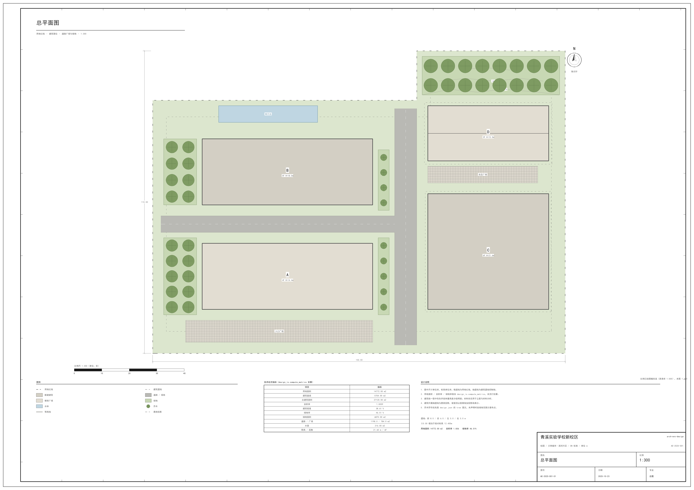
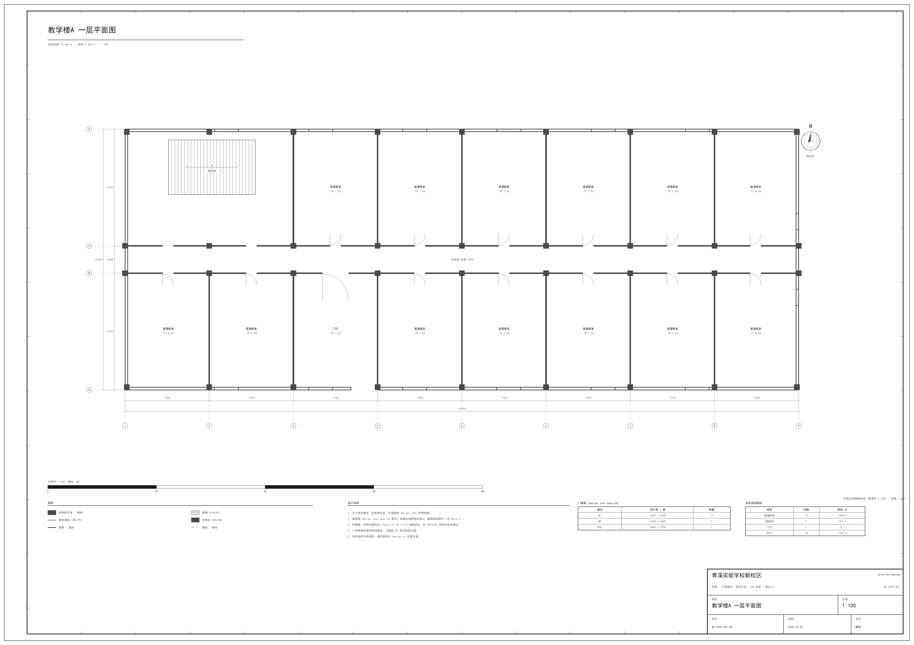

# arch-env-design · 建筑 + 环境设计技能

一个可**自动执行**的建筑 / 环境（景观）设计技能：给一块用地和一份功能需求，它把设计意图写成机器可算的 `design.json`，真算指标，出 A1 图纸，导 CAD / glTF，按 GB·CJJ 与 IBC·LEED 双体系校核，并从 28 个真实案例里按手法检索先例。

设计判断仍归你——选址、功能配比、形式取向；它负责把判断变成**可算、可查、可交付**的东西。

```
design.json  ──┬─→  metrics.json（容积率/密度/绿地率/高度/停车，全部由几何算）
               ├─→  siteplan / plan / section  →  SVG + PDF（A1 图框）+ PNG（自检）
               ├─→  design.dxf（R12/AC1009，8 图层）+ model.glb（glTF 2.0，PBR）
               ├─→  checklist（概念 8 / 方案 19 / 深化 23 条，PASS·WARN·FAIL·UNVERIFIED）
               └─→  case-find（28 案例 / 112 受控手法标签）
```



## 为什么是它

| 常见做法 | 这个技能 |
|---|---|
| 让模型「估」容积率 | 由 `design.json` 几何**真算**，算不出就报缺口 |
| 出一张示意图 | 三张 A1 正式图：双线图框、标题栏、指北针、比例尺、图例、设计说明、技术经济指标表、尺寸链、轴号、门窗表 |
| 图纸和指标各说各话 | 全部产物同源于一个 JSON，改数即改全部 |
| 依赖一堆外部转换器 | **零外部程序**：DXF 手写 ASCII、PDF 手写结构（文字走字体轮廓）、glTF 手写，只要 Python + numpy/Pillow/lxml |
| 编造规范条号 | 只写「规范名 + 指标名 + 限值」，不确定标 `[待核]`，缺口一律 `UNVERIFIED` |

## 快速开始

```bash
# 0 结构自检（改完 design.json 立刻跑；退出码 0 正常 / 1 有错 / 2 有警告）
<python> scripts/core/schema_lint.py examples/demo-campus/design.json

# 1 真算指标
<python> scripts/core/design_io.py check examples/demo-campus/design.json --json

# 2 出三张 A1 图（SVG 源 + PDF 正式图 + PNG 预览）
<python> scripts/core/to_pdf.py examples/demo-campus/design.json --out out

# 3 导 CAD 与三维
<python> scripts/core/dxf_export.py  examples/demo-campus/design.json --out out/design.dxf
<python> scripts/core/gltf_export.py examples/demo-campus/design.json --out out/model.glb

# 4 规范校核
<python> scripts/check/checklist.py examples/demo-campus/design.json --stage 方案 --json

# 5 检索先例（自然语言也行）
<python> scripts/cases/find.py --problem 滨水修复 --limit 5
```

`<python>` 是占位符：**先探测出一个真能跑的解释器**，再逐条替换。

```powershell
$cands = @($env:DSH_PYTHON) + @(Get-ChildItem "$env:DSH_HOME\dsh-runtimes\*\dependencies\python\python.exe" -ErrorAction SilentlyContinue | ForEach-Object FullName) + @('py','python3','python')
foreach ($c in $cands) { if (-not $c) { continue }; try { $v = & $c --version 2>&1; if ($LASTEXITCODE -eq 0 -and "$v" -match 'Python 3') { "PY=$c"; break } } catch {} }
```

> Windows 头号坑：没装 Python 时 `python` 是 Microsoft Store 占位符，`Get-Command python` 照样能找到，但每次调用都以**退出码 9009** 结束、stderr 为空——看起来像「脚本没输出」。**先看退出码，再相信输出。**

## 安装

```bash
git clone https://github.com/jaspercolecole-stack/arch-env-design.git
cd arch-env-design
```

技能目录是 bundle 形式（`<name>/SKILL.md`），DSH 热加载，无需重启：

```powershell
# 用户级（所有会话可用）
.\install_skill.cmd -Scope User
# 或工作区级（仅当前工作区）
.\install_skill.cmd -Scope Workspace -WorkspaceRoot "D:\path\to\workspace"
```

`.cmd` 只是用 `-ExecutionPolicy Bypass` 调 `install_skill.ps1`，绕开「脚本未数字签名」的拦截；直接跑 `.ps1` 时若被执行策略挡住，用 `powershell -NoProfile -ExecutionPolicy Bypass -File .\install_skill.ps1` 或先 `Set-ExecutionPolicy -Scope Process Bypass`。

手动安装也简单：把 `SKILL.md`、`references/`、`scripts/`、`assets/`、`examples/` 复制到 `<skills 根>/arch-env-design/` 即可。

## 目录

```
SKILL.md                 唯一入口，只做路由（按需求跳到对应 reference）
references/              9 份方法文档：workflow · cases · aesthetics · codes-cn · codes-intl
                         drawing-standards · checklist · interoperability · report-deck
scripts/core/            design_io · schema_lint · draw2d · svg_draw · to_pdf
                         pdf_backend · png_backend · svg_backend · dxf_export · gltf_export
scripts/check/           checklist.py（三阶段规范校核）
scripts/cases/           find.py（案例检索）
scripts/interop/         run_ext.py（外部程序调用：编码探测、退出码透传、超时杀树）
assets/                  case-library.json（28 案例 / 112 标签）· palette.json（色板）
examples/demo-campus/    design.json + expected/（三张 SVG、DXF、GLB）
verify_skill.py          18 项自检器（不属于技能本体，用来验收交付）
```

## 真跑过的样子

示例工程 `demo-campus`（虚构但自洽：4 栋教学楼 27,120 m²）：

| 项 | 结果 |
|---|---|
| 指标 | 用地 14,772 m² · 建筑 27,120 m² · 密度 0.3861 · 容积率 1.8359 · 绿地率 0.4651 · 限高 21.6 m（限值 2.0 / 0.40 / 0.35 / 24.0，全部在限内） |
| 图纸 | 三张 A1，637 / 634 / 736 个图元；PDF 1,691,349 / 1,643,527 / 1,535,609 B；PNG 273,766 / 232,206 / 256,336 B |
| DXF | 14,613 B，纯 ASCII，`$ACADVER AC1009`，8 图层齐全 |
| GLB | 10,188 B，5 mesh / 24 node / 9 material / 50 三角形；文件内无绝对路径，换目录重导 SHA256 一致 |
| 规范 | 深化阶段 PASS 22 · FAIL 0 · UNVERIFIED 1（`DET-NODE-01`：本技能不出 1:20 节点详图，属诚实缺口） |
| 案例检索 | 10 条自然语言查询全部非空（滨水修复→碧山宏茂桥；旧厂房改造→PSA） |
| 泛化 | 第二个工程：L 形用地 78×96 m 带 30×42 m 凹口、3 栋体量，同套脚本闭环跑通（用地 5,868 m² 与手算一致） |



## 自检

```bash
<python> verify_skill.py --skill . --work _verify
```

18 项全绿：文件骨架、指标偏差、案例标签封闭性、检索非空、三阶段校核、SVG/PDF/PNG 出图、出图来源（必须是 `svg_draw` 不走回退）、DXF 图层、GLB 结构、绘制顺序不变量、schema 覆盖、文档引用可落地。

## 已知限制（诚实清单）

1. **不出节点详图**：图纸集到 1:100 / 1:200，1:20 放大节点不在能力内（`DET-NODE-01` 恒为 UNVERIFIED）。
2. **绿地率按面积相减**（用地 − 建筑基底），不认 `design.json` 里声明的绿地多边形。
3. **规范校核到「指标 + 限值 + 名」级别**，不逐字判定条文；条号不确定标 `[待核]`，绝不编造。
4. **结构校验不是完整 JSON Schema validator**：`oneOf / patternProperties / minProperties` 未实现，以 warning 明示而不静默通过。
5. **无 `.dwg` / `.skp` 读写**：DWG 与 SKP 是封闭格式，一律以 DXF R12 / GLB 作交换层；需要原生格式时在软件里另存。
6. **SketchUp 不支持无头批处理**（Ruby API 依附 `Sketchup.active_model`）；3ds Max 走 `3dsmaxbatch.exe -mxs`。
7. 剖面窗按「每开间居中」等分排布，与逐洞口 x 中心不一一对应。

## 软件接入

| 软件 | 自动路径 | 说明 |
|---|---|---|
| AutoCAD 2026 | `accoreconsole.exe /i <dwg> /s <scr>` | `/s` 必填；`/?` 回显是 UTF-16LE |
| SketchUp 2025 | 无真无头模式 | 走 glTF / OBJ 交换 + 人工确认 |
| 3ds Max 2022 | `3dsmaxbatch.exe -mxs "<expr>" -listenerLog <log>` | `3dsmaxcmd.exe` 只做渲染，不是自动化入口 |
| 任意 CAD / 查看器 | DXF R12 · glTF 2.0 GLB | 技能自己生成，不依赖任何转换器 |

## 许可

MIT，见 [LICENSE](LICENSE)。
